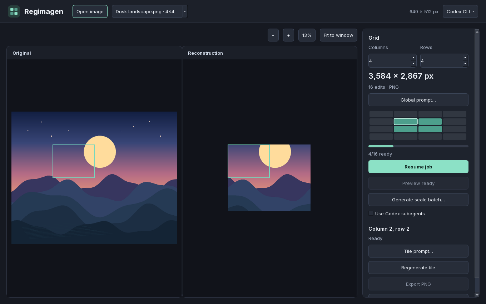

# Regimagen

[](https://github.com/LeGustaVinho/regimagen/releases/latest)
[](#quick-start)
[](docs/CLI.md)
[](#develop-from-source)

**Layered image editing and generative reconstruction with Codex ImageGen.** Compose and retouch images in the Windows app, use Generative Fill or Generative Remove on a selection, or reconstruct the visible composition at a larger size. The JSON CLI automates reconstruction and tile export.

[Download Windows ZIP](https://github.com/LeGustaVinho/regimagen/releases/latest/download/Regimagen-Windows-x64.zip) · [CLI reference](docs/CLI.md) · [Report an issue](https://github.com/LeGustaVinho/regimagen/issues/new)



*Reconstruction mode showing a 2×2 preview within a 4×4 job, using simulated tiles.*

## Features

- **Canvas and layers.** Move, reorder, duplicate, hide, and lock layers. Use rectangular and lasso selections to crop the canvas or work on part of a layer. Save editable layers, masks, and pixels together in a portable `.regimagen` project.
- **Manual retouching.** Paint pixels or masks with the brush and eraser. Rotate, flip, and resize layers, or preview brightness, contrast, and saturation adjustments. Undo and redo edits in the current session. Export the composition as PNG or WebP with transparency, or JPEG with a white background.
- **Generative Fill.** Choose **New layer** to use the visible composition, or **Active layer** to edit a visible, unlocked raster layer. Select an area, describe the edit, and compare variations before applying. Turn on **Edit Transparency** to add or remove coverage. To reduce the selection of a previously saved image version, open it from **Recent** and choose **Image version → Reopen fill**.
- **Generative Remove.** Click an object or draw around it with **Lasso**, review the proposed area, and remove it on a separate layer. [Generative Remove workflow](#generative-remove)
- **Configurable reconstruction.** Choose at least 2 columns and 2 rows. Regimagen previews the output size and tile count before generation and suggests the smallest grid that can fit at least 2× the source dimensions.
- **Reusable 2×2 previews.** Check a four-tile region before running the full grid. The full job reuses completed tiles from the same grid.
- **Art direction and review.** Set a global prompt and per-tile overrides, inspect seams with synchronized zoom, and regenerate individual tiles.
- **Scale batches.** Generate exact multiples of the original size. Each stage can use the original input or the preceding stage's result.
- **Flexible exports.** Export a lossless PNG with source transparency, or a ZIP of completed tiles with placement metadata. Fully transparent tiles are completed locally and included in both exports. The CLI can also export an individual tile.
- **Local checkpoints.** Completed tiles and prompts are saved in the workspace. Pause or resume long jobs and enable Codex subagents when you want parallel generation.

Use the preview and seam review to check generated tiles before committing to a large grid. Regimagen sends image references to Codex under your account when it requests generation or visual analysis.

## Quick start

1. To follow this guide on the current branch, [build the portable Windows ZIP](#develop-from-source) and extract the whole folder. Keep `_internal` beside the executables. The ZIP bundles the Python runtime and application dependencies. Published downloads follow their corresponding GitHub release tags.
2. Open `Regimagen.exe` on Windows 10 or 11 x64. Drop in a still PNG, JPEG, WebP, or `.regimagen` project. To start from transparency, choose **New canvas**.
3. Use **Add layer** to import another image or create a paintable layer. Choose **File → Save project** to keep your layers, or **File → Export image** to publish the composition.
4. Install Codex CLI and run `codex login` for **Generative Fill**, **Reconstruct**, and the parts of **Generative Remove** that use visual analysis or background reconstruction. If automatic detection misses it, choose the executable from the **Codex CLI** menu. [Codex CLI documentation](https://developers.openai.com/codex/cli/)
5. In **Reconstruct**, run **Generate 2×2 preview**, inspect the result, then choose **Generate image**. Use **Open result in editor** to work on the completed image at its generated size. You can also export the PNG or a ZIP of tiles.

## Generative Remove

1. Open **Generative Remove** in the layered editor. Use **Click** for one object or **Lasso** to draw around one or more objects. If you already made a selection in the editor, choose **Detect objects** to analyze it.
2. Check the outlined area. Amber shows where a proposed edit extends beyond the lasso. When detailed review opens, check the objects and effects you want to remove. Use **Refine selection** to open this review for a simple selection. **Add** and **Subtract** let you adjust the area, and **Detect objects and effects** can identify shadows, reflections, and nearby objects to protect. Choose **Use selection manually** to work directly from your lasso.
3. Choose **Remove**, then inspect the result with **Before** and **After**. For a reconstructed background, use **Generate another** to compare an alternative. **Apply** adds the chosen result as a reversible layer. Use **File → Save project** to keep the layers and **File → Export image** to save a PNG with transparency.

The bundled EfficientSAM model proposes outlines on the CPU. Ambiguous selections and background reconstruction use Codex. On transparent images, Regimagen can clear exposed empty areas locally. When part of a selection needs reconstruction, the request marks that part and includes surrounding image context. The composition preserves pixels outside the approved area and in protected regions. Inspect boundaries at the intended export size before applying a variation.

## CLI and AI automation

The portable archive also includes `regimagen-cli.exe`. It runs without a desktop window and returns UTF-8 JSON. Use the runtime command schema for discovery and the reference for workflows, state transitions, and retry behavior. [CLI reference](docs/CLI.md)

```powershell
.\regimagen-cli.exe capabilities
.\regimagen-cli.exe doctor --check-login
.\regimagen-cli.exe plan --file .\image.png --grid 4 4
```

## Develop from source

On Windows x64, use [uv](https://docs.astral.sh/uv/) with Python 3.14.

```powershell
uv sync --locked --group dev
uv run python -m regimagen
uv run regimagen-cli capabilities
uv run pytest -q
```

The test suite covers the editor, generative selection and compositing, portable projects, saved-job compatibility, and CLI recovery using simulated ImageGen results. The optional `tools/validate_imagegen.py` script runs a live check and uses your Codex quota. See `--help` for its options.

Build the portable archive with `.\tools\build-portable.ps1`. The build prepares and verifies the pinned EfficientSAM model, then writes `dist\Regimagen-Windows-x64.zip` with the desktop app, CLI, model, and documentation. Pass `-DistSubdirectory NAME` to write the archive under `dist\NAME`. To prepare the model ahead of a source run, use `uv run python -m regimagen.remove_model`.

## Third-party components

The Windows package includes Qt for Python, CPython, and other redistributable components. See the bundled notices for license texts and corresponding source links. [Third-party notices](THIRD_PARTY_NOTICES.md)
